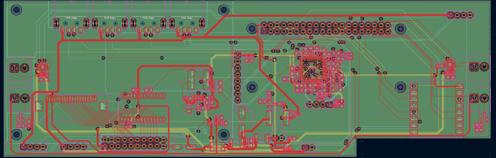
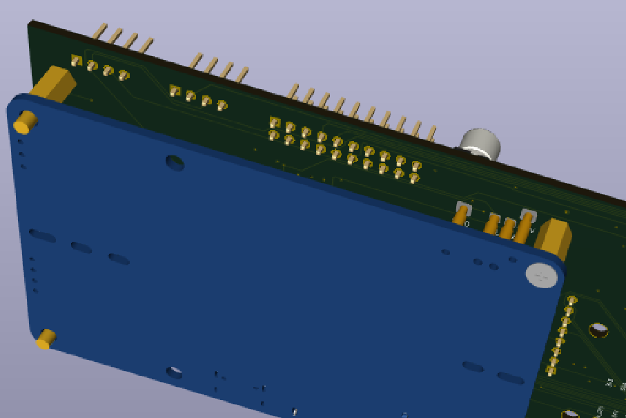
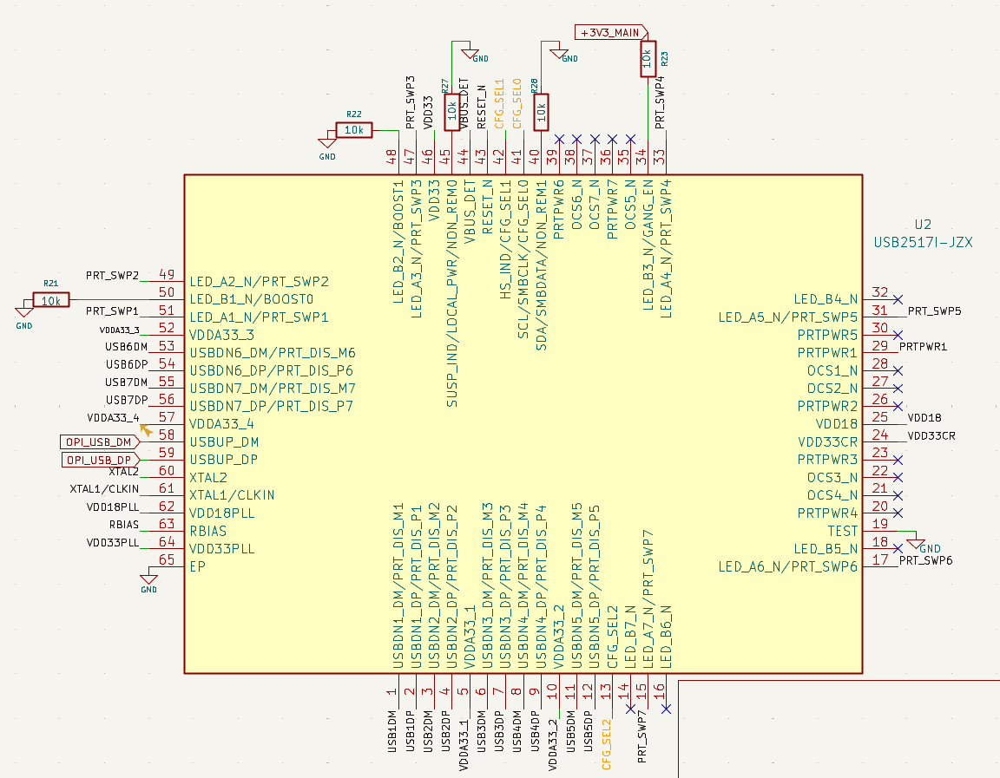
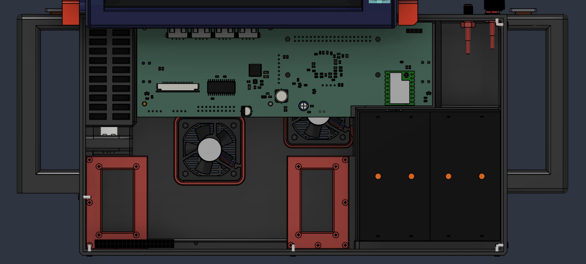
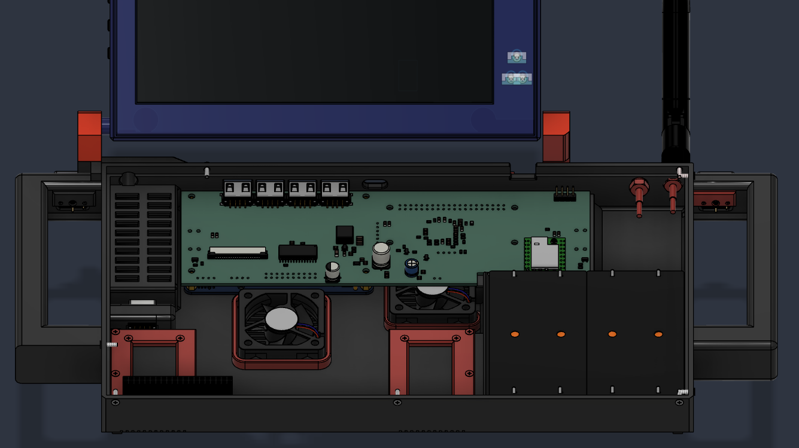

# Doomsday Deck

**The Doomsday deck is a handheld computer powered by orange pi zero 3w , its main goal is to use it for offgrid communication like using it for the lora communication , doing sdr stuff using a RTL sdr v3 and tinkering with the external hardware using the gpio header!!**

## Enclosure and Carrier Renders

<table width="100%">
  <tr>
    <td colspan="2" align="center">
       
      <strong>Enclosure — Front</strong>
    </td>
  </tr>
  <tr>
    <td colspan="2" align="center">
       
      <strong>Enclosure — Back</strong>
    </td>
  </tr>
  <tr>
    <td width="50%" align="center">
       
      <strong>Carrier Board — Front</strong>
    </td>
    <td width="50%" align="center">
       
      <strong>Carrier Board — Back</strong>
    </td>
  </tr>
</table>

## What Is It?

Doomsday Deck is a custom-built, portable cyberdeck which is mde for daily computing,offline computation, and electronics experimentation all in one!!. The Deck uses an Orange pi zero 3w as the main sbc a 7inch Display,Custom Mechanical keyboard,20000 mah battery system,RTL Sdr,A lora module,External 20Gpio pins for adding external devices or tinkering with other hardware....

## Why I Built It

I Always find out the Cyberdecks to be so cool and i used to saw lots of videos releated to it and i always wanted to build one for my self , so when i got my RTL sdr and wanted to use it on daily basis, because of my Gaming laptop i was not able to use it properly so i thought why not make a Deck which will satisfy all my needs [SATTELITE COMMUNICATION , ELECTRONICS ] So i built it , this is totally made on my own flawour and all the parts used are the one i will really use on my daily basis and for sure this will be my daily driver..

### Carrier PCB Layouts

<table>
  <tr>
    <td width="50%" align="center" valign="top">
       
      <em>C-PCB1</em>
    </td>
    <td valign="top">
      <strong>Carrier PCB — routing and placement view</strong>  
      This view shows the component placement, connectors, mounting holes, board outlines, and routed connections on the carrier PCB.The carrier board is a four layer pcb , first layer consisting the Signal+Power, the second layer is the whole Ground layer where all the gnd connections of all the components are grounded up third layer too is Signal+Power , but i tried to use very few connections in the third layer because this is one of my starter pcb and lots of thing could go wrong so i keep very less signal traces in the third layer to make debugging simpler , fourth and the last layer is Signal only this has all the remaining important traces routed and if anything goes wrong we can easily diagnose the board easily.
    </td>
  </tr>
  <tr>
    <td width="50%" align="center" valign="top">
       
      <em>CPCB2</em>
    </td>
    <td valign="top">
      <strong>Carrier PCB —UPS HAT'S CONNECTION WITH THE CARRIER BOARD</strong>  
      A second view of the carrier-board Shows the 3d model of the ups hat mechanically aligning to the carrier board which is clearly not made for it instead the UPS HAT is made for a rasberry pi 5 so by making a custom footprint by myself i managed to mechanically align the POGO pins of the UPS HAT to the pads of my carrier board , thanks to the good documentation of the waveshare , i managed to get all the mechanical knowledge abt the UPS HAT and using their original step file i managed to pin the position's of the pins and made the footprint which works perfectly fine with our carrier board.
    </td>
  </tr>
  <tr>
    <td width="50%" align="center" valign="top">
       
      <em>C-PCB3</em>
    </td>
    <td valign="top">
      <strong>Carrier PCB -INTERNAL USB HUB</strong>  
      this is one of the most hard part for me in this project , cause it was my first time integrating any ic in my project and frist time desigining the schematics around it , this is a custom made internal usb hub powered by the UPS HAT i previously mentioned abt , the data lines are directly connected to the Orange pi using the type c pins and the Orange pi and the carrier board / ic shares same gnd so it becomes easy to borrow the current from the UPS instead of getting it from the orange pi!!
    </td>
  </tr>
</table>

### Enclosure and Internal Arrangement

<table>
  <tr>
    <td width="50%" align="center" valign="top">
       
      <em>Base Deck</em>
    </td>
    <td valign="top">
      <strong>Base deck and component packaging</strong>  
      The base model shows how all the internal components are alligned inetrnally , there are not all the step files in the screenshot but there are more compontents like the lora module , speakers , battery are on the opposite side , i also made the space for the ventilation so that the internals of the deck remains cool though the orange pi has the heat sink + fan but still with three in total fans , i think everythning will remain cooler under the load !!
    </td>
  </tr>
  <tr>
    <td width="50%" align="center" valign="top">
       
      <em>Upper Front / Base</em>
    </td>
    <td valign="top">
      <strong>Upper-front and base fit</strong>  
      This view is to show how the upper-front structure Connects with the base.
    </td>
  </tr>
</table>

## Assembly steps

1.  **Prepare the parts** --- First gather all the requireed components , You can even solder the components on the pcb manually by hand or do the PCBA from a reputed brand , then after gathering two pcb's (carrier+keyboard's , take a screen , main sbc (orange pi ), battery pack , display cable (fpc), antenna , another e ink display etc .
2.  **Assemble the enclosure** --- Fit the base, display frame and
    hinge. Check that the display opens and closes freely and that no
    cable is pinched and is free to move smoothly in both directions .
3.  **Install the carrier PCB** --- Secure it at the designed mounting
    points you can even refer the step files . Check that the PCB cannot touch conductive or any other enclosure parts like rtl sdr , or antena or speakers .
4.  **Install the Orange Pi** --- Mount the Orange Pi Zero 3W and
    connect its 40-pin interface to the carrier board. and also connect the type c cables to the carrier board's USB C .
5.  **Install the power system** --- Mount the UPS HAT (E). Check all the pin orientaion before  
    connecting to the carrier board , refer the carreir pcb's files for this make sure that all the pins are connecting to the carrier pcb and not even a single pin is left out .
    place the batteries in the case of the battries , connect the 27100 battries in the battery case of the deck..
6.  **Install the peripherals** --- Fit the display, keyboard,
    joystick/OLED, LoRa module, e-paper display, USB hub, speakers and
    fans in their designated positions. Connect each cable to its
    matching labelled connector, respective silkscreen is already added on the pcb to make the work simpler.
7.  **Route and secure cables** --- Keep wires clear of the hinge make sure that there is enough  wires left for the movement of the       display. there are not much wires in the deck as everything is connected via (fpc or pcb's) but still wherever the wires are make sure that they are secure properly using the glue or zip tie 
8.  **Close the enclosure** --- Check fasteners, clearances, connector
    access and display movement before fitting the final cover. secure the whole enclosure using the heat inserts and proper m.2 screws as mentioned in the bom 

9.  **Start the deck** --- Check check if its booting (install any armbian os ), fans are starting , both screens are powering up
    lastly check everything if all the compoennts are working properly and there are no issues left , if there is any issue of devices not connecting properly , then there might be the issue with the firmware and not the deivce if everythng is done properly , i wil post another guide releated to it when the project is in build time !!

### Features

| Feature | Purpose |
|---|---|
| **Orange Pi Zero 3W compute platform** | Main computer board for local tools and portable Linux use. |
| **LoRa communication** | Low-powered longrange  messaging using a Waveshare SX1262-based module.|
| **20-pin GPIO expansion** | Expose SBC GPIO and expansion interfaces for add-on electronics(personal fav!!). |
| **2.13-inch tri-colour e-paper display** | Low-power status or reference display. |
| **Scroll encoder and joystick** | Navigation, shortcuts, and pointer-style input. |
| **RTL-SDR Blog V3** | A wide band radio reciever. |
| **Two 5 V 40 × 40 × 10 mm fans** | Move air through the enclosure and help manages temperatures in enclosure |
| **Two 8ohms 2w Electromagnetic Speakers** | for good audio... |

## Bill of Materials

| Part | Quantity | Total Price (INR) | Total Price (USD) | Supplier | Product Link |
|---|---:|---:|---:|---|---|
| DISP1 — Waveshare 7HP-CAPQLED 7-inch display | 1 | 6639.00 | 68.60 | Robu.in | [Product](https://robu.in/product/waveshare-7inch-1024x600-capacitive-touch-qled-quantum-dot-display-with-gg-toughened-glass-panel-and-various-systems-support/) |
| SW1-SW60 — Kailh Choc V1 switches - selected Choc Yellow variant | 60 | 2880.00 | 29.76 | Neo Macro | [Product](https://neomacro.in/products/kailh-choc-v1-switches?variant=49466990264598) |
| KC1-KC60 — Chocfox CFX Choc blank keycaps - 1U set | 60 | 2100.00 | 21.70 | Neo Macro | [Product](https://neomacro.in/products/chocfox-cfx-choc-blank-keycaps?variant=49467026833686) |
| PICO-KB1 — Raspberry Pi Pico 2 | 1 | 544.00 | 5.62 | Robu.in | [Product](https://robu.in/product/raspberry-pi-pico-2/) |
| BAT1-BAT4 — Samsung INR21700-50S Li-ion cells | 4 | 2076.00 | 21.45 | Robu.in | [Product](https://robu.in/product/samsung-inr21700-50s-3-6v-5000mah-9c-li-ion-battery/) |
| UPS1 — Waveshare UPS HAT (E) | 1 | 3866.77 | 39.96 | Sharvi Electronics | [Product](https://sharvielectronics.com/product/ups-hat-e-for-raspberry-pi-supports-4x-21700-li-batteries-not-included-bi-directional-fast-charging-5v-6a-output-pogo-pins-connector-raspberry-pi-ups-waveshare/) |
| EINK1 — Waveshare 2.13-inch 3-colour e-Paper HAT | 1 | 1178.82 | 12.18 | Zbotic | [Product](https://zbotic.in/product/waveshare-2-13inch-e-ink-paper-display-hat-for-raspberry-pi-three-color/) |
| RF1-RF2 — SMA male to U.FL/IPEX pigtail, 150mm | 2 | 113.26 | 1.17 | Sharvi Electronics | [Product](https://sharvielectronics.com/product/sma-male-connector-to-ufl-interface-cable-150mm-length/) |
| SD1 — SanDisk Ultra 128GB microSDXC UHS-I Class 10 | 1 | 2829.00 | 29.23 | Robu.in | [Product](https://robu.in/product/sandisk-micro-sdxc-ush-i-128gb-class-10-memory-card/) |
| ENC1 — M5Stack Scroll Unit with hollow-shaft encoder | 1 | 609.00 | 6.29 | Robu.in | [Product](https://robu.in/product/m5stack-scroll-unit-with-hollow-shaft-encoder-ec10e1220501/) |
| FAN1-FAN2 — 4010 5VDC 0.2A cooling fan | 2 | 251.26 | 2.60 | Sharvi Electronics | [Product](https://sharvielectronics.com/product/4010-5vdc-0-2a-cooling-fan-40x40x10-mm/) |
| J3 — 2×20 female 2.54mm GPIO socket | 1 | 13.00 | 0.13 | Robu.in | [Product](https://robu.in/product/2-54mm-2x20-pin-female-double-row-header-strip-pack-of-5/) |
| SPK1-SPK2 — FT5030DS0820 speaker | 2 | 531.00 | 5.49 | Sharvi Electronics | [Product](https://sharvielectronics.com/product/ft5030ds0820-8-ohm-2-watt-20khz-88db-electromagnetic-speaker/) |
| LORA1 / J2 — Waveshare Core1262-LF LoRa module | 1 | 983.22 | 10.16 | Sharvi Electronics | [Product](https://sharvielectronics.com/product/sx1262-lf-lora-node-module-sx1262-chip-set-410-to-510mhz-waveshare/) |
| INS1-INS3 — M2×4mm brass heat-set inserts | 3 | 45.00 | 0.46 | Robu.in | [Product](https://robu.in/product/m2-x-4-mm-brass-insert/) |
| SCR1-SCR2 — M2×8mm 304 stainless countersunk Phillips screws | 2 | 141.00 | 1.46 | Robu.in | [Product](https://robu.in/product/easymech-ss-304-csk-countersunk-philips-head-m2-x-8-mm-bolt-25-pcs/) |
| C1,C3,C6,C10,C14-C18,C20,C22,C30,C32-C33,C35 — 100nF 0805 ceramic capacitors | 15 | 13.80 | 0.14 | Robu.in | [Product](https://robu.in/product/100nf-0805-surface-mount-multilayer-ceramic-capacitor-pack-of-40/) |
| C2,C5,C19,C21,C23-C24,C27-C28 — 1uF 25V X7R 0805 ceramic capacitors | 8 | 25.32 | 0.26 | Robu.in | [Product](https://robu.in/product/gcm21br71e105ka56k-murata-electronics-25v-1uf-x7r-%c2%b110-0805-multilayer-ceramic-capacitors-mlcc-smd-smt-rohs/) |
| C4 — 100uF 16V radial through-hole electrolytic capacitor | 1 | 11.62 | 0.12 | Robu.in | [Product](https://robu.in/product/100uf-16v-electrolytic-capacitor-pack-of-20/) |
| C7 — 470uF 16V SMD aluminium electrolytic capacitor | 1 | 11.40 | 0.12 | Robu.in | [Product](https://robu.in/product/efvh016ada471m08b0-follon-470uf-16v-%c2%b120-smdd8xl10-5mm-aluminum-electrolytic-capacitors-smd-rohs/) |
| C8 — 47pF 50V C0G/NP0 0805 capacitor | 1 | 11.22 | 0.12 | Robu.in | [Product](https://robu.in/product/c2012c0g1h470jt000n-tdk-50v-47pf-c0g%c2%b15-0805-multilayer-ceramic-capacitors-mlcc-smd-smt-rohs/) |
| C9 — 10uF 25V X7R 1206 capacitor | 1 | 12.87 | 0.13 | Robu.in | [Product](https://robu.in/product/cs3216x7r106k250nri-samwha-25v-10uf-x7r-%c2%b110-1206-multilayer-ceramic-capacitors-mlcc-smd-smt-rohs/) |
| C11-C12 — 22uF 16V X7R 1206 capacitors | 2 | 24.00 | 0.25 | Robu.in | [Product](https://robu.in/product/cs3216x7r226k160nri-samwha-16v-22uf-x7r-%c2%b110-1206-multilayer-ceramic-capacitors-mlcc-smd-smt-rohs/) |
| C13,C31,C34 — 10uF 16V X7R 0805 capacitors | 3 | 30.00 | 0.31 | Robu.in | [Product](https://robu.in/product/0805b106k160nt-fh-16v-10uf-x7r%c2%b110-0805-multilayer-ceramic-capacitors-mlcc-smd-smt-rohs/) |
| C25-C26 — 15pF 50V C0G/NP0 0805 capacitors | 2 | 10.40 | 0.11 | Robu.in | [Product](https://robu.in/product/tcc0805cog150j500bt-cctc-smt-ceramic-capacitors-0805-cog-150j15pf%c2%b15-0-rated-voltage50v-thickness0-60mmtape/) |
| C29 — 47uF 10V X7R 0805 capacitor (price held pending effective-capacitance check) | 1 | — | — | Sharvi Electronics | [Product](https://sharvielectronics.com/product/47uf-47000nf-10v-capacitor-%c2%b120-tolerance-0805x476m100ct-0805-package/) |
| C36 — 100uF 25V SMD aluminium electrolytic capacitor | 1 | 10.40 | 0.11 | Robu.in | [Product](https://robu.in/product/ves101m1etr-0607-lelon-100uf-25v-%c2%b120-smdd6-3xl7-7mm-aluminum-electrolytic-capacitors-smd-rohs-2/) |
| F1,F5 — 3A resettable PPTC fuse, 1812 | 2 | 48.00 | 0.50 | Robu.in | [Product](https://robu.in/product/msmd300-techfuse-8v-100a-3a-5a-1812-resettable-rohs/) |
| F2 — 2920 resettable fuse candidate (price held pending exact-part verification) | 1 | — | — | Robu.in | [Product](https://robu.in/product/asmd2920-050-shenzhen-jdt-fuse-60v-100a-500ma-1a-2920-resettable-rohs/) |
| F3 — 350mA hold / 750mA trip resettable fuse, 1206 | 1 | 14.04 | 0.15 | Robu.in | [Product](https://robu.in/product/nsmd035-techfuse-6v-100a-350ma-750ma-1206-resettable-rohs/) |
| F4 — 1.5A hold / 3A trip resettable fuse, 1812 | 1 | 14.43 | 0.15 | Robu.in | [Product](https://robu.in/product/msmd150-techfuse-8v-100a-1-5a-3a-1812-resettable-rohs/) |
| L1 — 6.8uH shielded power inductor | 1 | 34.00 | 0.35 | Robu.in | [Product](https://robu.in/product/swpa8040s6r8mt-sunlord-6-8uh-20-3-6a-31ohm-smd-8-0x8-0x4-0mm-power-inductors/) |
| Q1 — SI2347DS-T1-GE3 P-channel MOSFET | 1 | 32.00 | 0.33 | Robu.in | [Product](https://robu.in/product/si2347ds-t1-ge3-vishay-si2347ds-t1-ge3-power-mosfet-p-channel-30-v-5-a-0-033-ohm-sot-23-surface-mount/) |
| Q2 — 2N7002-7-F single N-channel MOSFET | 1 | 18.00 | 0.19 | Robu.in | [Product](https://robu.in/?s=2n7002%207%20f&post_type=product) |
| Q3-Q4 — AO3400A N-channel MOSFETs | 2 | 18.00 | 0.19 | Robu.in | [Product](https://robu.in/product/1-month-warranty-414/) |
| R1,R10-R23,R25,R27-R28 — 10kΩ 0805 resistors | 18 | 20.40 | 0.21 | Robu.in | [Product](https://robu.in/product/rc0805fr-0710kl-yageo-res-thick-film-0805-10k-ohm-1-0-125w1-8w-%c2%b1100ppm-c-pad-smd-t-r/) |
| R2,R6,R7,R24,R26,R30,R33 — 100kΩ 0805 resistors | 7 | 16.40 | 0.17 | Robu.in | [Product](https://robu.in/product/ac0805fr-7w100kl-yageo-res-thick-film-0805-100k-ohm-1-0-25w1-4w-%c2%b1100ppm-c-pad-smd-t-r-automotive-aec-q200/) |
| R3 — 22.1kΩ 0805 resistor | 1 | 11.00 | 0.11 | Robu.in | [Product](https://robu.in/product/rc0805fr-0722k1l-yageo-125mw-thick-film-resistors-150v-%c2%b1100ppm-%e2%84%83-%c2%b11-22-1k%cf%89-0805-chip-resistor-surface-mount-rohs/) |
| R4 — 1MΩ 0805 resistor | 1 | 11.20 | 0.12 | Robu.in | [Product](https://robu.in/product/rc0805fr-131ml-yageo-125mw-thick-film-resistors-%c2%b1100ppm-%e2%84%83-%c2%b11-1m%cf%89-0805-chip-resistor-surface-mount-rohs/) |
| R5 — 12kΩ 0805 resistor | 1 | 10.50 | 0.11 | Robu.in | [Product](https://robu.in/product/rc0805fr-0712kl-yageo-res-thick-film-0805-12k-ohm-1-0-125w1-8w-%c2%b1100ppm-c-pad-smd-t-r/) |
| R31-R32 — 100Ω 0805 resistors | 2 | 10.50 | 0.11 | Robu.in | [Product](https://robu.in/product/rc0805fr-07100rl-yageo-res-thick-film-0805-100-ohm-1-0-125w1-8w-%c2%b1100ppm-c-pad-smd-t-r/) |
| SBC1 — Orange Pi Zero 3W 12GB (listed reference price; availability to confirm) | 1 | 21680.00 | 224.02 | Peach Imports | [Product](https://peachimports.com/products/orange-pi-zero-3w-12gb-lpddr5-allwinner-a733-octa-core-cpu-3-tops-single-board-computer-2-0ghz-frequency-wifi-6-bluetooth-5-4-ble-onboard-antenna-support-4k-display-run-android-ubuntu?_pos=1&_sid=8aff34c7b&_ss=r) |
| R34 — 210kΩ 0805 resistor | 1 | 10.78 | 0.11 | Robu.in | [Product](https://robu.in/product/crcw0805210kfkea-vishay-intertech-125mw-thick-film-resistors-150v-%c2%b11-%c2%b1100ppm-%e2%84%83-210k%cf%89-0805-chip-resistor-surface-mount-rohs/) |
| U1 — TPS54302DDCT buck regulator | 1 | 45.96 | 0.47 | Sharvi Electronics | [Product](https://sharvielectronics.com/product/tps54302ddct-4-5-v-to-28v-3a-emi-friendly-synchronous-step-down-converter-ic-sot-23-package/) |
| U2 — Microchip USB2517I-JZX USB 2.0 hub controller | 1 | 440.00 | 4.55 | Robu.in | [Product](https://robu.in/product/usb2517i-jzx-microchip-usb-interface-usb-2-0-3-v-3-6-v-qfn-64-pins/) |
| U3 — USB 2.0 ESD protector candidate (price held pending package/MPN verification) | 1 | — | — | Robu.in | [Product](https://robu.in/product/1-month-warranty-1014/) |
| U4-U5 — MAX98357AETE+T I²S class-D amplifier | 2 | 518.00 | 5.35 | Robu.in | [Product](https://robu.in/product/max98357aetet-maxim-integrated-products/) |
| U7 — MCP23017-E/SO I²C GPIO expander | 1 | 295.00 | 3.05 | Robu.in | [Product](https://robu.in/product/mcp23017-e-so-microchip-i-o-expander-16-bit-i2c-serial-1-8-v-5-5-v-soic-28-pins/) |
| Y1 — 24.000MHz 4-pad SMD crystal, 8pF, 20ppm | 1 | 34.00 | 0.35 | Robu.in | [Product](https://robu.in/product/yxc-ysx211sl-24mhz-8pf-20ppm-4pad-smd-crystal/) |
| J1 — E-paper interface / 8-pin solder/header interface | 1 | — | — | PCB fabrication | — |
| J4 — UPS HAT E pogo-pad interface | 1 | — | — | Custom PCB | [Product](https://www.waveshare.com/wiki/UPS_HAT_%28E%29) |
| J5 — EXT-GPIO primary 2×10 2.54mm connector (per supplied schematic screenshot) | 1 | — | — | TBD | — |
| J6 — 2-pin 2.54mm display 5V/GND output | 1 | — | — | PCB fabrication | — |
| J7,J9-J11 — USB-A female right-angle SMD receptacles | 4 | 63.75 | 0.66 | Sharvi Electronics | [Product](https://sharvielectronics.com/product/a-type-usb-female-connector-pcb-mount-right-angle-smd/) |
| J8 — USB-C upstream data interface (currently incorrectly shown as 1×4 header) | 1 | — | — | TBD | [Product](https://robu.in/product/White%202A%200.5m%20Type%20A%20to%20Type%20C%20USB%20Cable) |
| J12-J14 — Three internal 4-wire USB 2.0 solder interfaces | 3 | — | — | Custom PCB | — |
| J15-J18 — 4 × 2-pin fan/speaker connector interfaces | 4 | — | — | Robu.in / Sharvi as in prior list | [Product](https://robu.in/product/2-pins-3-96mm-pitch-jst-vh-connector-with-housing-pack-of-10/) |
| J19 — 2×10 backup/debug GPIO pads/header footprint | 1 | — | — | Custom PCB | — |
| USB-C1 — USB-A-to-USB-C cable, 0.5m, 2A label | 1 | 69.00 | 0.71 | Robu.in | [Product](https://robu.in/product/White%202A%200.5m%20Type%20A%20to%20Type%20C%20USB%20Cable) |
| USB-MICRO1-USB-MICRO2 — USB-to-Micro-USB cable, 1m | 2 | 78.00 | 0.81 | Robu.in | [Product](https://robu.in/product/usb-to-micro-usb-cable-wire-1m-for-nodemcu/) |
| PICO-HDR — Pico 2 mounting headers/socket (confirm configuration) | 1 | — | — | TBD / already owned | — |
| PCB-CARRIER — Custom carrier PCB fabrication | 1 | — | — | TBD (PCB house) | — |
| PCB-KEYBOARD — Keyboard PCB fabrication - JLCPCB (5-board lot) | 1 | 1151.63 | 11.90 | JLCPCB | [Product](https://jlcpcb.com/) |
| JLC-ENG-FEE — JLCPCB engineering fee | 1 | 387.10 | 4.00 | JLCPCB | [Product](https://jlcpcb.com/) |
| SHIP-JLC-KEYBOARD — JLCPCB UPS Worldwide Express shipping estimate | 1 | 943.56 | 9.75 | JLCPCB / UPS Worldwide Express | [Product](https://jlcpcb.com/) |
| 3D PRINTING — Enclosure, panels and internal brackets (free via Printing Legion) | 1 set | 0.00 | 0.00 | Printing Legion (Hack Club) | [Product](https://printlegion.hackclub.com/) |
| HDMI-CABLE — Mini-HDMI-to-HDMI video cable/adapter | 1 | — | — | TBD | — |
| TOUCH-CABLE — USB-A-to-display-touch USB cable / harness | 1 | — | — | TBD | [Product](https://www.waveshare.com/7hp-capqled.htm) |
| DISPLAY-PWR-CABLE — 5V display power cable/harness | 1 | — | — | TBD | [Product](https://www.waveshare.com/wiki/7HP-CAPQLED) |
| SBC-DATA-CABLE — SBC USB-C host-to-hub upstream connection | 1 | — | — | TBD | — |
| FFC1 (for proposed J20 to adapter board) — 20-pin 1.00mm-pitch, 50mm FPC-A ribbon cable (Robu SKU 1042210) | 1 | 14.00 | 0.14 | Robu.in | [Product](https://robu.in/product/1mm-pitch-20-pin-50-mm-fpc-a-type-ribbon-flexible-flat-cablepack-of-5/) |
| ANT1 — 50Ω antenna for selected Core1262 module band | 1 | — | — | TBD | — |
| ESD-DOWNSTREAM — Additional low-capacitance USB 2.0 ESD protection arrays | 4 | — | — | TBD | — |
| USB-PWR-SWITCH — USB port power switch / ganged switch with current limit and active-low fault output | 1 | — | — | TBD | [Product](https://ww1.microchip.com/downloads/en/DeviceDoc/USB2517-Hardware-Design-Checklist-00004211.pdf) |
| USB-HARNESS — Internal 4-wire USB harnesses / strain relief | 3 | — | — | TBD | — |
| USB-PD-CHARGER — Official Raspberry Pi 27W USB-C PD supply (5.1V/5A); charger for UPS HAT (E), not SBC-port supply | 1 | 1349.00 | 13.94 | Amazon India | [Product](https://www.amazon.in/dp/B0D4DM1D21) |
| RTL-SDR — RTL-SDR Blog V3 R860 RTL2832U SDR dongle with TCXO, bias tee and dipole antenna kit | 1 | — | — | Self-sourced by user (Amazon listing for identification only) | [Product](https://www.amazon.in/RTL-SDR-Blog-RTL2832U-Software-Defined/dp/B0BMKB3L47) |
| J20 (provisional - assign unique ref in KiCad) — 20-pin 1.00mm FPC/FPC ZIF connector, bottom contacts, flip type | 1 | 54.44 | 0.56 | Sharvi Electronics | [Product](https://sharvielectronics.com/product/20-pin-fpc-ffc-smt-bottom-contacts-flip-connector-1mm-pitch/) |
| ADP-FPC1 (off-board adapter; not a PCB designator) — 20-pin FFC/FPC adapter board, 1.00mm FPC to 2.54mm through-hole breakout | 1 | 56.00 | 0.58 | Sharvi Electronics | [Product](https://sharvielectronics.com/product/ffc-fpc-adapter-board-1mm-to-2-54mm-soldered-connector-20-pin/) |
| SHIP-RESERVE-25USD — Shipping reserve — USD 25 (return unused balance to project budget) | 1 | 2419.39 | 25.00 | Unallocated project budget reserve | — |
| D1-D60 — MMSD4148T3G SMD switching diode, SOD-123 (change PCB footprint from DO-35) | 60 | 201.00 | 2.08 | Robu.in | [Product](https://robu.in/product/mmsd4148t3g-onsemi-100v-independent-1v10ma-4ns-200ma-sod-123-switching-diodes-rohs/) |
| EQP-HOTPLATE — Serplex EU-plug SMD rework heating plate, 12.1 × 7 cm | 1 | 673.00 | 6.95 | Amazon India | [Product](https://www.amazon.in/Serplex%C2%AE-Soldering-Desoldering-12-1x7cm-Aluminum/dp/B0GQ3GBKPT) |
| CONS-SOLDER-PASTE — DHRUVPRO Sn63/Pb37 SMD solder paste, 35 g syringe | 1 | 849.00 | 8.77 | Amazon India | [Product](https://www.amazon.in/DHRUVPRO-Assembly-Sn63-Pb37-Soldering/dp/B0BBHF1P49) |
| EQP-TWEEZERS — THEMISTO 5-in-1 powder-coated stainless-steel tweezer set | 1 | 279.00 | 2.88 | Amazon India | [Product](https://www.amazon.in/THEMISTO-Stainless-Powder-Coated-Tweezer/dp/B07P9R8PP3) |
| TOTAL BUDGET — priced BOM items plus $25 shipping reserve; unpriced items excluded; return unused reserve to project budget | — | 56831.44 | 587.25 | — | — |

