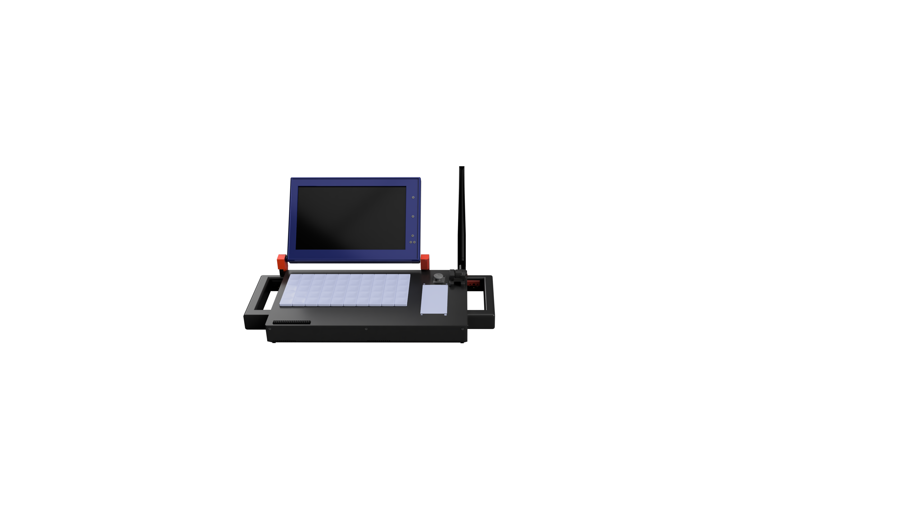
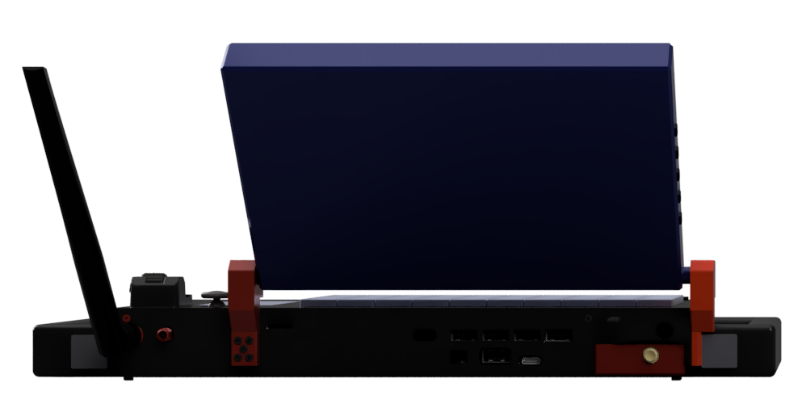
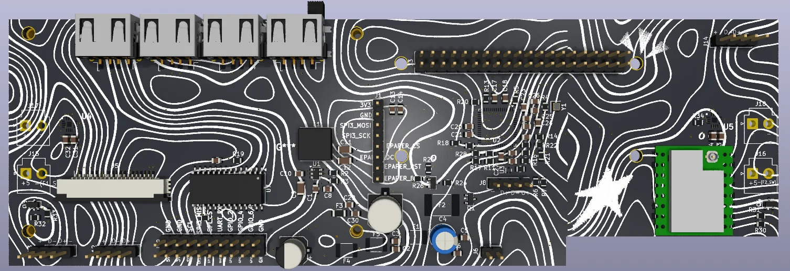
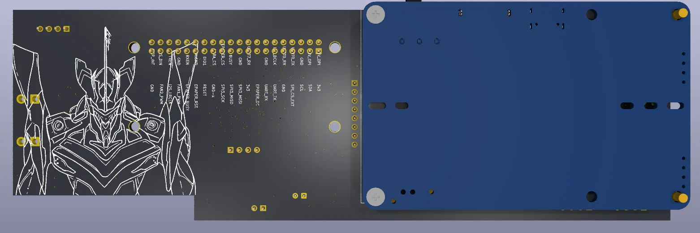

# Doomsday Deck

A custom portable cyberdeck for computing, offline communication, electronics, and field experimentation.

## Enclosure Renders

### Front View

  

### Back View

  

## Carrier Board Renders

### Front View

  

### Back View

  

## Planned Features

| Feature | What it adds |
|---|---|
| **Offline LoRa communication** | A Waveshare SX1262 LoRa module is planned for low-data-rate messaging without relying on cellular service or internet access. Range depends on antenna, terrain, configuration, and local radio rules. |
| **Modular GPIO expansion** | A custom carrier board exposes a 40-pin SBC header and expansion interfaces for add-on hardware. The final pin mapping must be verified against the exact SBC revision before fabrication. |
| **7-inch touchscreen** | A 1024 × 600 capacitive-touch display serves as the main interface. |
| **Secondary e-paper display** | A 2.13-inch tri-colour e-paper HAT is planned for low-power status or reference information. |
| **USB peripheral expansion** | A custom USB 2.0 hub is intended to connect accessories such as the touchscreen interface, keyboard peripherals, and RTL-SDR receiver. |
| **Battery-powered operation** | A Waveshare UPS HAT (E) with four 21700 Li-ion cells is planned to provide a rechargeable 5 V power system. Actual runtime depends on load and battery configuration. |
| **60-key low-profile keyboard** | A custom keyboard PCB using Kailh Choc V1 switches and compatible keycaps provides integrated input. |
| **Scroll/encoder input** | An M5Stack Scroll Unit is planned for navigation or shortcut control. |
| **Integrated audio** | Two MAX98357A I²S amplifier channels and two speakers are planned for audio output. |
| **Software-defined radio** | An RTL-SDR Blog V3 receiver is included as a self-sourced USB accessory for receive-only RF experimentation. |
| **Active cooling** | Two 5 V 4010 fans are planned to move air through the enclosure. |
| **Custom enclosure** | A modular 3D-printed enclosure houses the display, keyboard, compute board, battery system, and expansion hardware. The current plan is to use Printing Legion for free supplier printing. |

## Bill of Materials

See [`BOM.csv`](BOM.csv) for the parts list, vendor links, and budget estimate. Prices and availability may change; treat the totals as estimates until checkout and fabrication quotes are confirmed.
